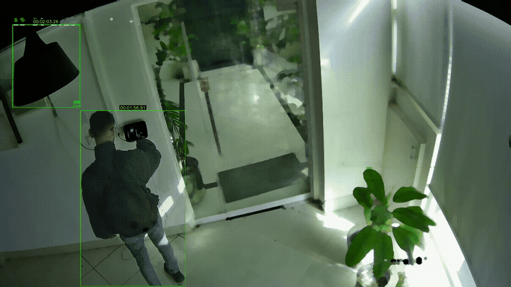

# 🎥 Video Synopsis with YOLOv8

**Turn hours of surveillance footage into minutes.** This project watches a long CCTV recording, detects and tracks people with YOLOv8, throws away the empty frames, and writes a short synopsis video that keeps only the moments that matter.

<p align="center">
  
</p>

## ✨ Results

Tested on a real **52-minute** waiting-area recording (2560×1440):

| Metric | Value |
|---|---|
| Original duration | 52.24 min |
| Synopsis duration | **7.25 min** |
| Compression ratio | **7.2×** |
| Idle frames removed | 66.7% |

## 📺 Demo

VIDEO_PLACEHOLDER

## ⚙️ How it works

```
Long CCTV video
      │
      ▼
Frame sampling (every 3rd frame)
      │
      ▼
YOLOv8n detection + tracking  ──►  person found?  ──no──►  drop frame
      │ yes
      ▼
Draw boxes & track IDs
      │
      ▼
Write to synopsis video (played back at 60 FPS)
```

1. **Sampling:** processes every 3rd frame, cutting redundant near-identical frames.
2. **Detection & tracking:** YOLOv8 (nano) detects people and keeps a consistent ID for each person across frames.
3. **Filtering:** frames with no person are dropped; frames with people are kept with their bounding boxes.
4. **Compression:** kept frames are written at a higher playback FPS, so the result is a fast, watchable summary.

## 🚀 Quick start

```bash
git clone https://github.com/mehreensaghar/video-synopsis.git
cd video-synopsis
pip install -r requirements.txt

python video_synopsis.py --input your_video.mp4 --output synopsis.mp4
```

Options:

| Flag | Default | Meaning |
|---|---|---|
| `--conf` | 0.4 | detection confidence threshold |
| `--skip` | 3 | process every Nth frame |
| `--fps` | 60 | playback speed of the synopsis |

Prefer notebooks? Open `video_synopsis.ipynb` (built for Google Colab).

## 🛠️ Tech stack

Python · YOLOv8 (Ultralytics) · OpenCV · NumPy

## 💡 Use cases

- Reviewing security footage in minutes instead of hours
- Footfall and occupancy analysis for waiting areas and branches
- Building datasets of human activity from long recordings

## 🔭 Next steps

- Overlay people from different times into the same frame (true object-based synopsis)
- Add timestamps to each kept clip
- Support more object classes (vehicles, bags)

---
Built by [Mehreen Saghar](https://github.com/mehreensaghar) as a proof of concept.
